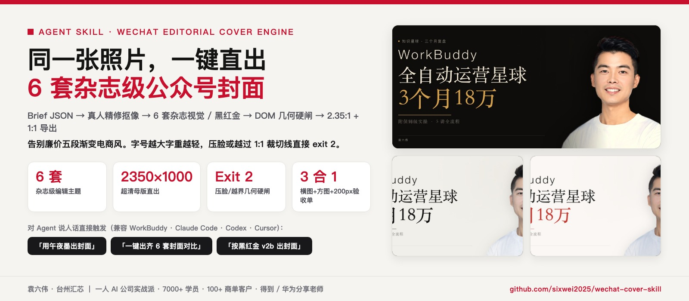
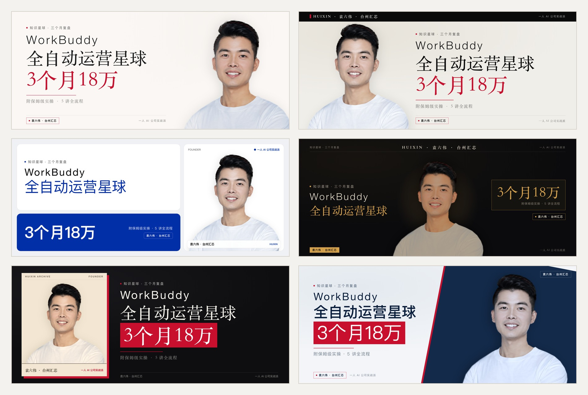
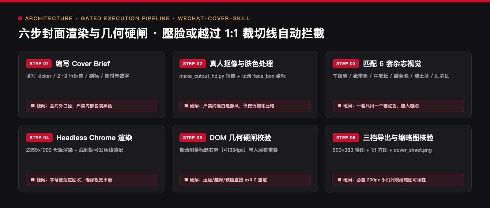

<div align="center">



# 公众号封面渲染引擎 Skill
### `wechat-cover-skill` · 6 套高客单价杂志视觉 + 黑红金 v2b + 防压脸自动校验

[](https://agentskills.io)
[](#五3-分钟安装与环境依赖)
[](#二视觉展示6-套杂志风--经典黑红金)
[](#三四条写进代码的造型与版面防遮挡标准)

> 🔴 **作者：袁六伟 · 台州汇芯**｜一人 AI 公司创业者，学员 7000+，客户 100+，得到 / 华为分享老师  
> 📮 更多 AI 工具实测与自动化实战，关注 **公众号 / 视频号：袁六伟**  
> 📌 **当前版本**：`v1.1.0`（2026-11-13）· 6 套视觉体系 × 6 种构图版式 · 详见 [CHANGELOG.md](CHANGELOG.md)

**告别「五段金色渐变 + 3D 立体投影 + 廉价电商红晕」。**  
用确定性的 HTML + Headless Chrome 渲染管线，把一份 JSON Brief 和一张真人半身抠像，一键渲染为 **2350×1000 超清母版**，并自动裁切导出 **900×383 公众号横图 + 带完整人脸的 1:1 分享方图 + 200px 缩略图四联验收单（`cover_sheet.png`）**。

```bash
# 一键安装到 WorkBuddy / Claude Code / Codex / Cursor
npx skills add sixwei2025/wechat-cover-skill

# 一键出齐 6 套杂志风封面对比
python3 skills/公众号封面skill/scripts/render_cover_themes.py --demo --out ./out
```

[6 套杂志风总览](#21-编辑设计范式封面六套2026-11-主力默认) · [经典黑红金 v2b](#22-经典黑红金-v2b-风格高冲击力工具实测向) · [防压脸自动校验](#三四条写进代码的造型与版面防遮挡标准) · [六步渲染流程](#四六步封面工程流水线) · [安装与换人像](#五3-分钟安装与环境依赖)

</div>

## 版本记录

当前版本：`v1.0.0` · 2026-11-13
完整变化记录见 [CHANGELOG.md](CHANGELOG.md)。


## 新手安装：把链接发给 AI

打开 Codex、WorkBuddy，或其他支持技能安装的 AI 智能体，把下面这段话直接发到对话框，让它帮你安装：

```text
帮我安装这个仓库里的技能：
https://github.com/sixwei2025/wechat-cover-skill
```

不需要自己先敲安装命令，按 AI 的提示完成即可。安装后可以接着问：“这个技能怎么用？带我做一个最简单的例子。”

需要使用能够读取仓库、操作本地文件并支持技能安装的 AI；如果当前平台不支持，它可以提供手动安装指引。部分技能还需要额外软件或账号配置，安装技能与完成这些配置是两步，按本页说明和 AI 提示继续。


---

## 一、它解决什么问题？

公众号封面有两个致命痛点：
1. **用 AI 生图画封面**：中文字体笔画粘连、每次生成长相不一样、没有真人 IP 辨识度，一眼假。
2. **用传统模板拼封面**：要么字压在人脸上，要么微信列表页自动裁成 `1:1` 方图时把标题切掉半截、把人脸切出一半。

本仓库用**代码级 DOM 边界检测**彻底终结这些问题：**文字右边界越过 `1334px`（1:1 裁切安全线）、标题压入 `face_box` 人脸框、或字号低于最小可读阈值，渲染脚本直接 `exit 2` 报错拦截**，逼迫 Agent 缩短文案重渲，绝不让废片流入草稿箱。

---

## 二、视觉展示：6 套杂志风 + 经典黑红金

### 2.1 编辑设计范式「封面六套」（2026-11 主力默认）

同一篇文章、同一张真人照片，通过 `scripts/render_cover_themes.py` 一键直出 6 套高客单价杂志封面：

<p align="center">
  
</p>

| 主题 ID | 风格名称 | 空间构图版式（`--layout`） | 底色 / 锚点色 | 最佳适用题材 |
| :--- | :--- | :--- | :--- | :--- |
| `brand` | **汇芯红** | `editorial-right`（经典左文右人 + IP 印章） | `#FAF7F4` / `#C8102E` 品牌红 | 通用主力，与汇芯红正文排版完全呼应 |
| `paper` | **纸本墨** | `portrait-left`（左人右文反转 + 顶通黑条报头） | `#F1EFEA` / `#C8102E` 汇芯红 | 方法论、核心观点、体系化长文教程 |
| `swiss` | **瑞士蓝** | `bento-grid`（Bento 三格圆角卡片拼贴） | `#EFF1F5` / `#002FA7` 克莱因蓝 | 行业报告、工具清单、横评数据表 |
| `midnight` | **午夜墨** | `center-hero`（人物正中 C 位 + 左右分列） | `#0B0B0D` / `#D4A04A` 暖金 | 带硬数字的复盘、搞钱算账、深夜深度长文 |
| `kraft` | **牛皮纸** | `card-black-split`（左米白档案卡 + 右纯黑大字） | `#0E0E10` + `#F3E7D3` / `#C8102E` | 个人经历、创业踩坑、案例故事复盘 |
| `indigo` | **靛蓝瓷** | `diagonal-cut`（11° 斜切双色海报） | `#F3F5F8` + `#132A4A` / `#C8102E` | AI 工具实测、产品发布、技术架构拆解 |

### 2.2 经典黑红金 v2b 风格（高冲击力工具实测向）

内置 `scripts/render_cover.py` 支持左文右人黑红金高对比度封面（白/金两行大字 + 红底斜切眉标 + 题材背景帧）：

<table>
  <tr>
    <td width="50%" align="center">
      
      <br /><sub><b>▲ 金标准样板 1</b>：黑红金左文右人 + 右侧真人精修抠像</sub>
    </td>
    <td width="50%" align="center">
      
      <br /><sub><b>▲ 金标准样板 2</b>：2350×1000 母版直出，200px 缩略图依然秒读</sub>
    </td>
  </tr>
</table>

---

## 三、四条写进代码的造型与版面防遮挡标准

1. **真人照片绝不做纯黑白**：中文公众号语境下，把真人半身照抽成纯黑白极易产生负面联想。代码已彻底移除黑白滤镜，统一采用「保留血色的低饱和彩照 + 纸感底色」。
2. **字号越大，字重越轻**：主标题 150px / `500` 字重，核心数字行 184px / **`400` 字重**——这是高级编辑杂志风与廉价促销横幅的分水岭。
3. **底部必配 Issue Strip**：发丝分割线 + 作者署名 + 期号，稳住 2.35:1 超宽画幅的重心。
4. **自动化四联验收单（`cover_sheet.png`）**：每次渲染自动输出横图、1:1 方图与 200px 手机列表缩略图同屏对照单，一旦检测到文字压脸或越界，直接返回非零退出码（`exit 2`）：

<p align="center">
  
</p>

---

## 四、六步封面工程流水线

<p align="center">
  
</p>

### 快速命令速查

```bash
# 1. 使用封面六套渲染单篇（推荐默认）
python3 skills/公众号封面skill/scripts/render_cover_themes.py   --brief cover-brief.json --theme midnight --out ./build/cover

# 2. 一次渲染全部 6 套主题，对比挑选最合身的一张
python3 skills/公众号封面skill/scripts/render_cover_themes.py   --brief cover-brief.json --demo --out ./build/cover-all

# 3. 使用经典黑红金 v2b 渲染器
python3 skills/公众号封面skill/scripts/render_cover.py   skills/公众号封面skill/templates/example-brief-xiaowangzi.json --out ./build/cover
```

---

## 五、3 分钟安装与环境依赖

### 1. 安装 Skill
```bash
npx skills add sixwei2025/wechat-cover-skill
```

### 2. 环境依赖
- **Python 3.9+**：`pip3 install pillow numpy scipy pyyaml`
- **Google Chrome / Chromium**：用于无头 DOM 测量与超清截图（可通过环境变量 `CHROME_BIN` 指定路径）
- **字体**：思源黑体 Heavy / `NotoSansCJKsc-Black.otf`（放到 `skills/公众号封面skill/assets/fonts/` 或安装至系统字体库）

### 3. 换成你自己的真人抠像（只需做一次）
```bash
python3 skills/公众号封面skill/scripts/make_cutout_hd.py   --src your_photo.jpg --box 0,0,1200,1500 --face 420,180,780,620
```
替换 `assets/owner_cutout_hd.png` 与坐标 JSON 后，所有压脸检测与 1:1 居中裁切会自动适配你的脸部位置。

---

## 六、仓库目录结构

```text
wechat-cover-skill/
├── README.md                                  # 仓库总览与视觉展示
├── LICENSE                                    # MIT 开源许可
├── assets/showcase/                           # 封面六套、黑红金样张、QA 验收单与架构图
└── skills/公众号封面skill/
    ├── SKILL.md                               # 【总控入口】封面六套、flat 纯黑与黑红金完整规范
    ├── rules.yaml                             # 标题字数、字号下限与几何裁切硬阈值配置
    ├── references/
    │   ├── 封面六套.md                        # 6 套杂志视觉配色 Token、四条硬规则与避坑记录
    │   └── cover-style-spec.md                # 黑红金 v2b 视觉规范说明
    ├── assets/
    │   ├── owner_cutout_hd.png                # 默认真人高清抠像资产（含脸部保护框坐标）
    │   └── default-bg-frame.jpg               # 示例题材背景帧
    ├── templates/
    │   ├── cover.html                         # 2350×1000 响应式排版与 DOM 测量模板
    │   ├── default-brief.json                 # 默认风格参数基线
    │   └── example-brief-xiaowangzi.json      # 完整 Brief 示例
    └── scripts/
        ├── render_cover_themes.py             # ★ 封面六套编辑风渲染引擎（主力）
        ├── render_cover.py                    # 黑红金 v2b 与 flat 模式渲染引擎
        ├── chrome_shot.py                     # Headless Chrome 截图与 DOM 几何边界提取器
        ├── make_cutout_hd.py                  # 真人半身照高清抠像与边缘羽化工具
        └── compare_refs.py                    # 新封面与标杆封面并排对照生成工具
```

---

## 关于作者与开源生态

**袁六伟 · 台州汇芯**：一人 AI 公司创业者，学员 7000+，服务商单客户 100+，覆盖近 20 个行业，得到 / 华为分享老师。AI 变现实战派，自己跑通才拿出来教。

- 公众号：**袁六伟**（微信搜一搜关注，看更多 AI 工具实测与一人公司实战）
- 视频号：**袁六伟**

这个项目免费开源。如果它帮你的产线省下了每天反复返工的时间，欢迎在右上角点个 ⭐ **Star**，也欢迎转发给身边做内容或一人公司的朋友。

### 同系列开源 Skill 矩阵（袁六伟 · 台州汇芯）

| 仓库 | 领域 | 核心能力 |
| :--- | :--- | :--- |
| [**workbuddy-wechat-autopilot**](https://github.com/sixwei2025/workbuddy-wechat-autopilot) | 公众号全链路 | 九步全自动总控：选题→写稿→真实截图→6套封面→6套排版→三重自动质检→草稿箱 |
| [**wechat-cover-skill**](https://github.com/sixwei2025/wechat-cover-skill) | 公众号视觉 | 封面渲染引擎（6套高客单价杂志风 + 黑红金 v2b + 防压脸自动校验） |
| [**gzh-million-layout-skill**](https://github.com/sixwei2025/gzh-million-layout-skill) | 公众号排版 | 汇芯红 `#C8102E` 六套 100% 内联 CSS 骨架 + 零乱码检查 + 配图皮肤 |
| [**ai-tool-review-wechat-skill**](https://github.com/sixwei2025/ai-tool-review-wechat-skill) | 公众号评测 | AI 工具真跑评测工作流（2.0 全自动压测 + 去碎句语感质检 + 六套骨架装配） |
| [**hit-title-expert-skill**](https://github.com/sixwei2025/hit-title-expert-skill) | 爆款标题 | 一次直出 10 条 14–22 字高浓缩狠标题（5大公式 × 5类钩子词） |
| [**auto-tutorial-skill**](https://github.com/sixwei2025/auto-tutorial-skill) | 短视频工程 | 链接/网页/真机截图 → 3:4 封面 + 1.5x 配音 + 红框标注教程视频 |
| [**talking-head-video-skill**](https://github.com/sixwei2025/talking-head-video-skill) | 短视频工程 | 1080×1920 竖屏真人口播短视频（ASR 错字校对 + 逐字卡拉OK字幕 + 6项QC） |
| [**3d-map-video-skill**](https://github.com/sixwei2025/3d-map-video-skill) | 短视频工程 | MapLibre 3D 地形 + WarFX 战争特效（粒子行军/点阵兵力/震屏混音） |
| [**psych-kepu-video-skill**](https://github.com/sixwei2025/psych-kepu-video-skill) | 短视频工程 | Remotion + JSON 驱动的 15–30s 深色扁平动画心理科普短视频 |
| [**dark-infographic-video-skill**](https://github.com/sixwei2025/dark-infographic-video-skill) | 短视频工程 | 纯 Python + FFmpeg 暗黑流光数据可视化科普片（含 v2 手机外放配乐） |
| [**local-video-hub**](https://github.com/sixwei2025/local-video-hub) | AI 团队基建 | 视频版本地 Obsidian：多 AI 员工统一交片、撞题查重与四态流转云台 |
| [**yuanliuwei-ai-skills**](https://github.com/sixwei2025/yuanliuwei-ai-skills) | 一人公司方法 | PACT 72h 需求验证模型与一人 AI 公司 10 大业务决策模块 |
| [**book-skill**](https://github.com/sixwei2025/book-skill) | 知识工程 | 上传任意书籍 PDF → 自动提炼方法论生成 `.skill` + 公众号导流文案 |
| [**huangdi-skill**](https://github.com/sixwei2025/huangdi-skill) | 认知操作系统 | 中国历史八大皇帝（秦始皇/汉武帝/唐太宗等）一手史料认知框架蒸馏 |
| [**sunrise-tracker**](https://github.com/sixwei2025/sunrise-tracker) | 选题雷达 | 小红书 AI 赛道 10 倍异常流量「低粉爆文」每日早 7 点监测推送 |
